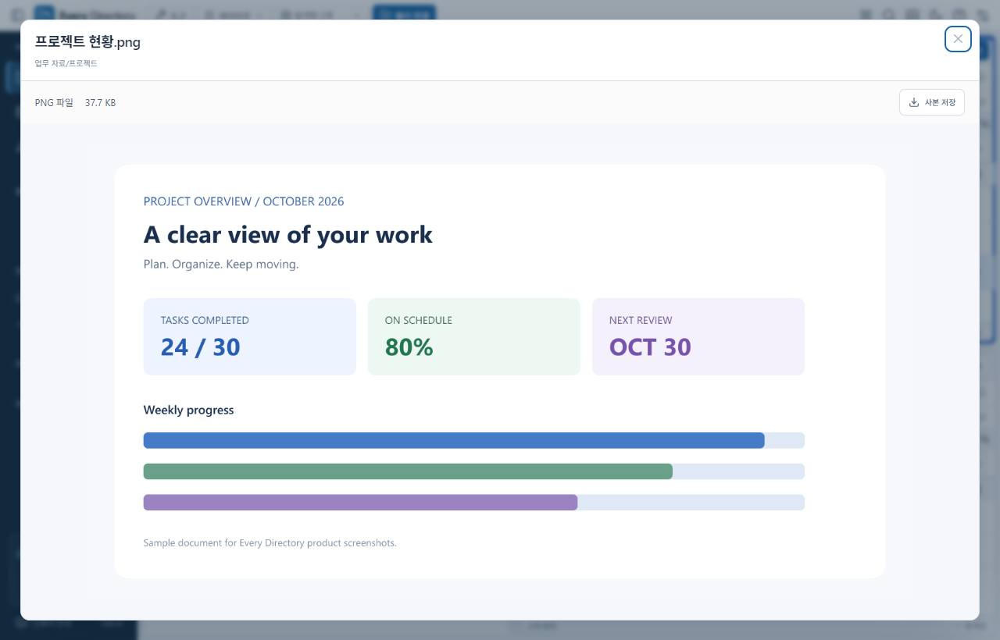
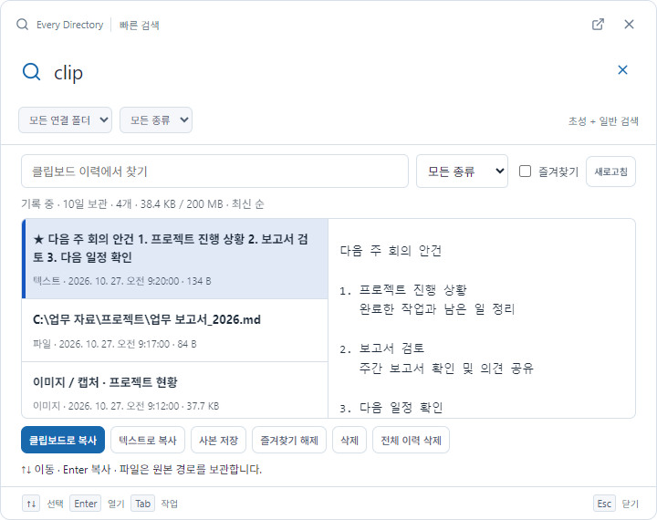
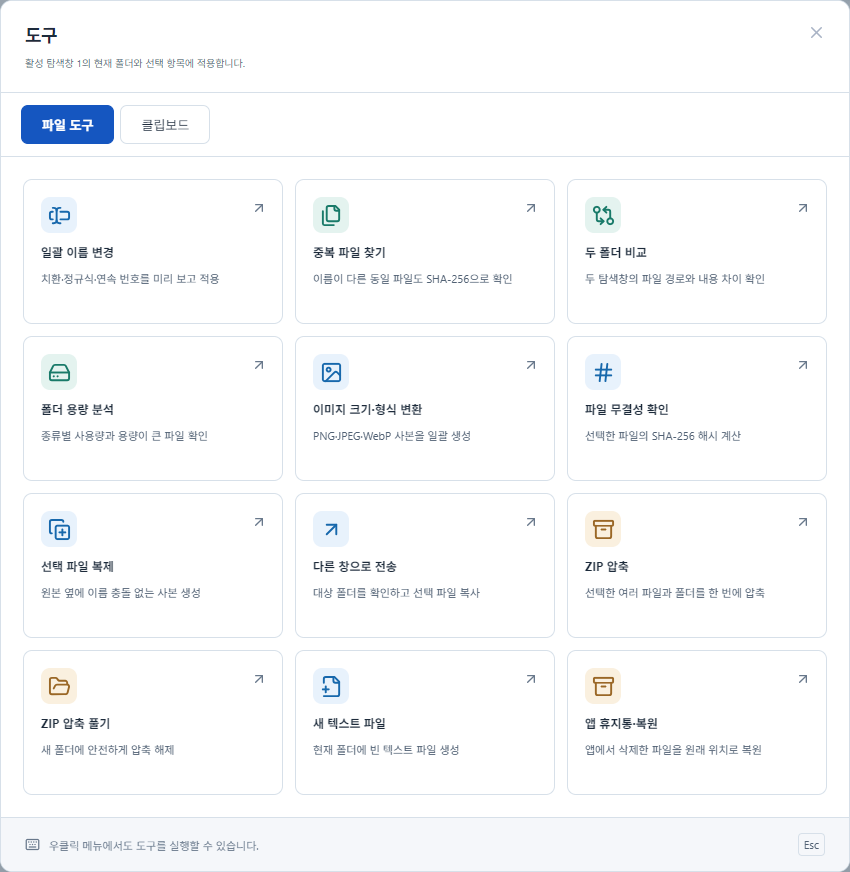

# Every Directory

**파일 찾기부터 미리보기·정리까지, 한곳에서.**

## Ctrl + Shift + Space로 빠른 검색

다른 작업 중에도 **Ctrl + Shift + Space**로 검색창을 열고 파일을 바로 찾으세요.

## 한국어 초성 검색

정확한 이름이 기억나지 않아도 **`ㅂㄱㅅ` → 보고서**, **`ㄱㅎㅇ` → 기획안**처럼 검색하세요. 일반 검색과 초성을 섞어 입력하고, 이름·경로에서 일치한 부분도 확인할 수 있습니다.

## SPACE로 빠른 미리보기

파일을 선택하고 **SPACE**를 누르세요. 이미지·PDF·텍스트를 미리 확인하고, **Esc**로 닫아 작업을 이어갈 수 있습니다.

## 복사한 내용을 다시 찾는 클립보드 이력

**Ctrl + Shift + Space → `clip` 입력 → Enter**로 이력을 여세요. 텍스트·파일·이미지·화면 캡처를 검색하고, 미리 보거나 다시 복사·저장할 수 있습니다.

보관 기간은 **기본 10일**, 설정에서 **1~60일**로 조절합니다. 호출 키워드도 변경할 수 있습니다. 파일 이력은 원본 경로를 보관합니다.

## 검색에서 파일 정리까지

- **여러 탐색창과 탭**으로 폴더를 함께 열기
- **복사·이동·드래그**로 파일 정리하기
- 현재 탭의 위치를 따라가는 **폴더 트리**
- 드래그로 조절하고 저장하는 **트리·칼럼 너비**
- **보기·정렬·분류·속성 칼럼**을 작업에 맞게 설정하기

## 반복 작업은 도구로 간편하게

**도구 → 파일 도구**에서 일괄 이름 변경, 중복 파일 찾기, 두 폴더 비교, 이미지 변환, ZIP 압축 등을 실행하세요. **클립보드** 탭에서는 이력을 따로 관리할 수 있습니다.

[GitHub에서 프로젝트 보기](https://github.com/hwanse85/every_directory)

*v0.10.0 · Windows x64. 단축키와 클립보드 기록은 앱 실행 중 동작하며, 사용자 설정은 다시 실행해도 유지됩니다. 이미지는 최신 프로그램 UI에 예시 데이터를 넣어 촬영한 미리보기입니다.*
