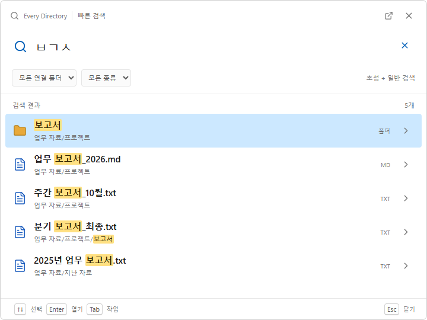
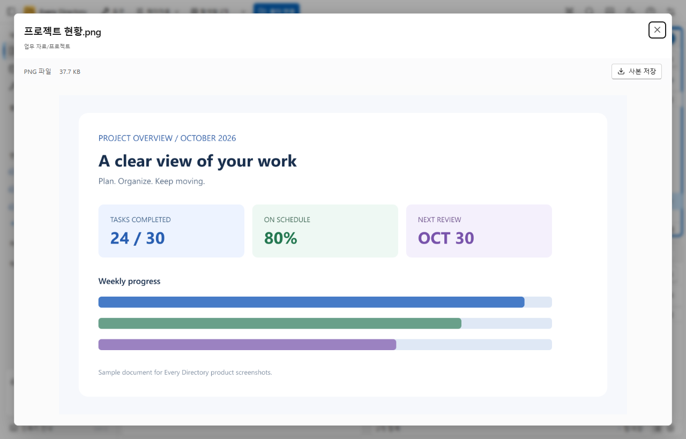
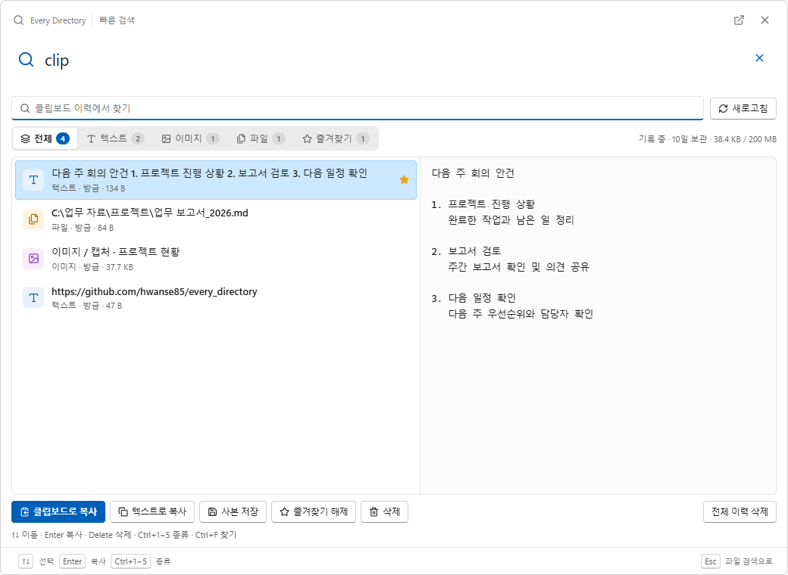
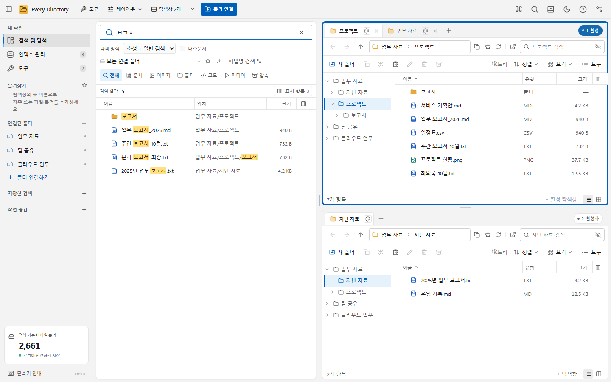
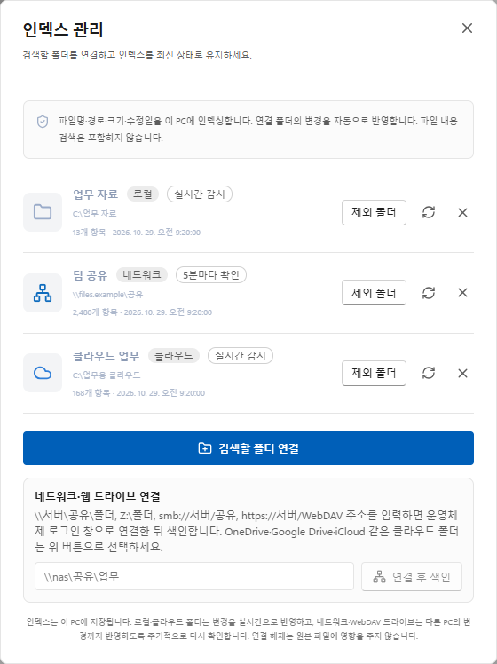

# Every Directory

**파일 찾기부터 미리보기·정리까지, 한곳에서.**

연결해 색인한 폴더의 파일명·경로를 검색하고, 여러 탐색창에서 바로 정리하세요.

## Ctrl + Shift + Space로 빠른 검색

다른 작업 중에도 **Ctrl + Shift + Space**로 검색창을 열고 파일을 바로 찾으세요.

## 한국어 초성 검색

정확한 이름이 기억나지 않아도 **`ㅂㄱㅅ` → 보고서**, **`ㄱㅎㅇ` → 기획안**처럼 검색하세요. 된소리와 일반 문자를 섞어 검색하고, 이름·경로에서 일치한 부분은 하이라이트로 확인하세요. 연결한 폴더 안의 경로를 빠른 검색에 입력하면 **Enter로 그 위치를 열 수 있습니다.**

## SPACE로 빠른 미리보기

파일을 선택하고 **SPACE**를 누르세요. 이미지·PDF·텍스트를 미리 확인하고, **Esc**로 닫아 작업을 이어갈 수 있습니다.

## 복사한 내용을 다시 찾는 클립보드 이력

**Ctrl + Shift + Space → `clip` 입력 → Enter**로 이력을 여세요. 텍스트·파일·이미지·화면 캡처를 검색하고, 미리 보거나 다시 복사·저장하세요. **종류별 탭과 즐겨찾기**로 필요한 이력을 빠르게 골라볼 수 있습니다.

보관 기간은 **기본 10일**, 설정에서 **1~60일**로 조절합니다. 호출 키워드도 변경할 수 있습니다. 파일 이력은 원본 경로를 보관합니다.

## 검색에서 파일 정리까지

- **여러 탐색창과 탭**으로 폴더를 함께 열기
- **복사·이동·드래그**로 파일 정리하기
- 현재 탭의 위치를 따라가는 **폴더 트리**
- 드래그로 조절하고 저장하는 **트리·칼럼 너비**
- **보기·정렬·분류·속성 칼럼**을 작업에 맞게 설정하기
- **Tab / Shift + Tab**으로 검색창과 탐색창 사이 이동하기
- PC에 등록된 형식을 사용하는 **Windows 새로 만들기**

## 네트워크·클라우드 폴더도 함께 검색

**인덱스 관리**에서 SMB·WebDAV 위치를 연결하거나, PC의 클라우드 폴더를 선택해 색인하세요. 네트워크 위치는 주기적으로 다시 확인하고, 검색에서 제외할 하위 폴더도 지정할 수 있습니다.

## 반복 작업은 도구로 간편하게

**도구 → 파일 도구**에서 일괄 이름 변경, 중복 파일 찾기, 두 폴더 비교, 이미지 변환, ZIP 압축 등을 실행하세요. **클립보드** 탭에서는 이력을 따로 관리할 수 있습니다.

[GitHub에서 프로젝트 보기](https://github.com/hwanse85/every_directory)

**v0.12.0 · Windows x64** — WebView2 Runtime이 필요합니다. 이번 검증 빌드는 설치형 **2.69 MiB**, 압축 실행형 **3.29 MiB**입니다.

*단축키와 클립보드 수집은 앱 실행 중 동작하며, 설정은 다시 실행해도 유지됩니다.*

*이미지는 현재 UI에 예시 데이터를 넣어 촬영한 브라우저 미리보기이며, 실제 서버 접속 화면은 아닙니다.*
