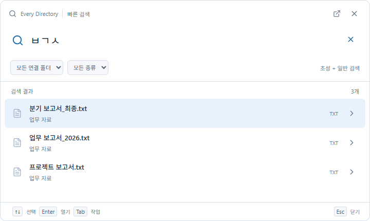
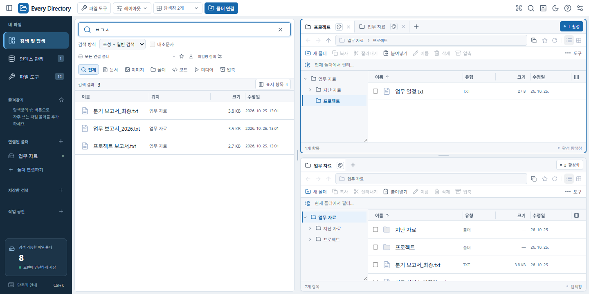

# Every Directory

**파일 찾기, 초성만으로 가볍게.**

## Ctrl + Shift + Space로 빠른 검색

다른 작업 중에도 단축키 한 번으로 검색창을 여세요. 파일을 찾고 바로 열 수 있습니다.

## 한국어 초성 검색

정확한 파일 이름이 기억나지 않아도 **`ㅂㄱㅅ` → 보고서**, **`ㄱㅎㅇ` → 기획안**처럼 초성으로 검색하세요. 일반 파일 이름과 확장자 검색도 지원합니다.

## 검색에서 파일 정리까지

- **여러 탐색창과 탭**으로 폴더를 함께 열기
- **복사·이동·드래그**로 파일 정리하기
- 현재 탭의 위치를 따라가는 **폴더 트리**
- 드래그로 조절하고 저장하는 **칼럼 너비**

[GitHub에서 프로젝트 보기](https://github.com/hwanse85/every_directory)

*Windows 10·11 (x64). Ctrl+Shift+Space는 앱 실행 중 사용하는 기본 단축키이며 설정에서 변경할 수 있습니다. 이미지는 예시 데이터로 구성한 프로그램 UI 미리보기입니다.*
