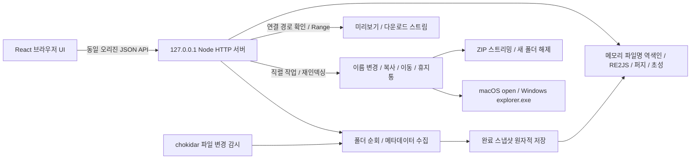

# 로컬 서버 기반 기술 설계

2026-10-23 / v0.4.0

## 결정

브라우저 단독 File System Access API 버전을 로컬 Node.js 서버와 React UI로 변경했습니다. 브라우저별 폴더 접근 권한·핸들 저장 제약을 없애고 서버가 직접 실제 디스크를 읽습니다. 기존 브라우저 IndexedDB 핸들은 이관하지 않습니다. 새 버전에서 폴더를 한 번 연결하면 서버에 저장됩니다.

Everything/Q-Dir의 원본 화면이나 실행 파일을 합치는 방식이 아니라 검색과 여러 탐색창의 작업 흐름을 구현합니다. Everything SDK 또는 Windows 서비스 설치는 필요하지 않습니다.

## 코드

| 파일                              | 역할                                                                                |
| --------------------------------- | ----------------------------------------------------------------------------------- |
| `server/main.ts`                  | 개발 Vite 미들웨어 또는 빌드 정적 파일 제공, HTTP API, 로컬 세션, 파일 Range 스트림 |
| `server/service.ts`               | 루트 등록·순회·변경 감시·직렬 갱신·디스크 스냅샷·파일 접근 경계                     |
| `server/operations.ts`            | 파일 작업·앱 휴지통·일괄 이름 변경·속성·해시·OS 연동                                |
| `server/archive.ts`               | ZIP 생성·해제, 경로·링크·크기 한도 검사                                             |
| `src/rename.ts`                   | UI·서버가 공유하는 이름 규칙과 일괄 변경 미리보기                                   |
| `src/components/FileActions.tsx`  | 파일 도구 모음·다중 선택 작업·작업 대화상자·단축키                                  |
| `src/search.ts`                   | 일반·와일드카드·RE2 정규식·퍼지·초성 검색과 폴더 목록                               |
| `src/client.ts`                   | 브라우저 HTTP 클라이언트와 1초 간격 상태 확인                                       |
| `src/components/FolderPicker.tsx` | 서버 폴더 선택 및 절대 경로 입력                                                    |
| `src/components/Preview.tsx`      | 텍스트 256KB 미리보기와 미디어 스트리밍                                             |
| `src/components/PdfPreview.tsx`   | 로컬 PDF.js Worker, 페이지별 캔버스 렌더링·페이지 이동·확대                         |
| `server/images.ts`                | sharp 이미지 사본 변환, 설치된 한글·영문 모델의 로컬 OCR                            |
| `src/components/ImageTools.tsx`   | 크기·형식 입력, OCR 결과 편집·복사·다운로드                                        |
| `src/components/CommandPalette.tsx` | 빠른 명령 검색·키보드 선택, 활성 탐색창의 도구 실행                               |
| `src/App.tsx`                     | 검색 설정·필터·배치·폴더 관리·탐색창 조정                                           |

## 검색 의미

- 일반 검색은 NFC 정규화, 선택적 대소문자 구분, AND·구문·확장자 필터를 지원합니다.
- 와일드카드는 전체 대상에 맞춥니다. 정규식 메타문자는 이스케이프하고 `*`와 `?`만 패턴으로 변환합니다. 필요한 이름의 3글자 키로 후보를 좁힙니다.
- 정규식은 원래 패턴과 문자열의 대소문자를 보존한 상태로 RE2JS에 전달하고 플래그로 대소문자를 처리합니다. JavaScript 네이티브 정규식의 임의 패턴 역추적을 피하기 위한 선택입니다. 전후방 탐색·역참조 미지원은 UI 오류로 안내합니다.
- 퍼지는 정확한 부분 문자열을 먼저 찾고, 파일명을 구분자로 나눈 단어에 제한된 편집 거리와 인접 문자 전치를 적용합니다. 점수가 작은 순서로 결과를 표시합니다.
- 초성은 한글 완성형 음절을 초성으로 정규화한 별도 문자열을 검색합니다. 영문과 숫자를 섞을 수 있습니다.
- 엔진이 약 650ms 시간 예산을 초과하면 `partial:true`와 확인된 결과·개수를 반환합니다. 브라우저는 부분 결과를 완전한 결과로 표시하지 않습니다.

## 지속성과 접근 범위

서버가 완료 스냅샷을 임시 파일에 쓴 뒤 rename으로 교체합니다. 순회·저장 실패 시 직전 완료 스냅샷을 유지합니다. 변경 감시는 파일 이벤트를 묶어 루트 전체를 재순회합니다. NTFS 전용 저널을 사용하는 Everything과 같은 규모의 증분 갱신 구조는 아닙니다.

서버는 loopback IPv4에 바인딩하며 Host/Origin과 로컬 세션 쿠키를 확인합니다. JSON API는 사용자 지정 헤더를 요구하고 CORS를 허용하지 않습니다. 파일 조회는 등록 루트·인덱스 존재 여부·상대 경로·실제 경로 경계를 확인합니다. 인덱싱 시 심볼릭 링크를 건너뜁니다. 파일 스트림은 별도 sandbox CSP와 nosniff를 적용합니다. 정적 앱 HTML에는 sandbox를 적용하지 않습니다.

## 파일 작업 설계

변경 요청은 인덱싱과 같은 서버 대기열에서 처리합니다. 실행 시점에 경로를 다시 확인하고 작업 성공·실패 후 연결된 루트를 재인덱싱합니다. 폴더 복사와 압축 해제는 같은 대상 드라이브의 임시 폴더에서 완료한 뒤 공개합니다. 기존 이름을 덮어쓰지 않습니다. 일괄 이름 변경은 이름 충돌을 미리 검사하고 임시 이름으로 이동한 뒤 적용하여 이름 순환·대소문자 변경을 처리합니다. 실패 시 복구를 시도하고 복구하지 못한 임시 파일은 남깁니다.

삭제는 원본과 같은 연결 루트 안의 앱 휴지통으로 rename하고 원래 경로·삭제 시점을 기록합니다. OS 휴지통에 의존하지 않아 두 운영체제에서 같은 UI로 복원합니다. 다른 볼륨 이동은 복사 완료 후 원본을 앱 휴지통에 보관합니다. OS 파일 클립보드 통합과 일반 실행 취소는 구현하지 않았습니다.

ZIP은 yazl/yauzl 스트림으로 처리해 별도의 압축 프로그램 설치가 필요하지 않습니다. 해제 시 경로 구성 요소마다 양쪽 운영체제에서 사용할 수 있는 이름인지 검사하고, 심볼릭 링크·중복 경로·암호화 항목과 10,000개·2GB 초과를 거부합니다.

PowerToys는 Windows 유틸리티 모음입니다. 이 앱에서는 [PowerRename](https://learn.microsoft.com/en-us/windows/powertoys/powerrename)의 미리보기·정규식 일괄 이름 변경과 [Peek](https://learn.microsoft.com/en-us/windows/powertoys/peek)의 빠른 미리보기 흐름을 참고했습니다. 자체 구현이며 macOS에서도 동일 UI를 사용합니다. UI 단축키는 Space로 지정했습니다.

PDF 미리보기는 브라우저 내장 플러그인 대신 지연 로딩하는 PDF.js와 로컬 Worker를 사용합니다. 파일 스트림의 sandbox CSP를 유지하면서 앱의 캔버스에 한 페이지씩 그립니다. 페이지 이동·확대·화면 폭 변경 시 이전 렌더를 취소하고 다시 그립니다.

이미지 사본은 sharp로 임시 폴더에서 변환합니다. 새 결과 폴더는 독점 생성하고 오류 시 이번에 만든 폴더와 임시 파일을 정리합니다. OCR은 npm 의존성의 한글·영문 압축 모델을 임시 로컬 경로에 준비하고 Tesseract.js Worker에 전달합니다. 모델 다운로드 경로는 외부 URL을 사용하지 않으며 인식 후 Worker와 임시 모델을 정리합니다. OCR은 동시에 하나만 처리하고 파일 변경 대기열을 점유하지 않습니다.

검색 결과 선택은 활성 탐색창의 현재 탭에 위치와 선택 항목을 전달하고, 실행은 기존 OS 연동 API를 사용합니다. 탐색창 활성 상태는 세션 안에서 관리하며 초기값은 첫 번째 창입니다. 빠른 명령은 대화상자의 초점 복원이 끝난 다음 실행해 선택한 탐색창이 이전 창으로 돌아가지 않게 합니다.

## 공식 참고 자료

- [Node.js HTTP](https://nodejs.org/api/http.html), [파일 시스템](https://nodejs.org/api/fs.html): 로컬 요청·스트리밍·메타데이터 접근.
- [Vite 서버 미들웨어 모드](https://vite.dev/guide/ssr.html#setting-up-the-dev-server): 개발 시 UI와 API를 하나의 서버에 제공.
- [RE2JS 공식 저장소](https://github.com/le0pard/re2js): RE2 문법과 검색·플래그·선형 매칭 API.
- [chokidar 공식 저장소](https://github.com/paulmillr/chokidar): 운영체제 파일 변경 감시와 심볼릭 링크 설정.
- [yazl](https://github.com/thejoshwolfe/yazl), [yauzl](https://github.com/thejoshwolfe/yauzl): ZIP 생성·지연 항목 읽기·크기 검증·파일 스트림.
- [PDF.js 예제](https://mozilla.github.io/pdf.js/examples/): Worker 설정과 페이지별 캔버스 렌더링.
- [sharp 크기 변경](https://sharp.pixelplumbing.com/api-resize/): 비율 유지·자르기·늘이기·확대 금지.
- [Tesseract.js](https://github.com/naptha/tesseract.js)와 [언어 데이터](https://github.com/naptha/tessdata): 로컬 Worker와 한국어·영어 모델.
- [Microsoft PowerToys](https://learn.microsoft.com/en-us/windows/powertoys/): 추가 탐색 도구의 사용 흐름 참고.
- [Everything 검색 문법](https://www.voidtools.com/en-us/support/everything/searching/): 검색 UX 참고. 현재 앱은 자체 검색 문법이며 Everything의 전체 문법 호환을 목표로 하지 않습니다.
- [Chrome File System Access](https://developer.chrome.com/docs/capabilities/web-apis/file-system-access): 초기 브라우저 단독 버전의 권한·선택기 제약 검토에 사용했습니다.

## 후속 확장

실제 수십만~수백만 파일과 Windows/네트워크 드라이브 측정 후 SQLite 저장·루트별 증분 색인·검색 전용 스레드 등 필요한 병목만 개선합니다. 파일 비교와 OS 휴지통·파일 클립보드 연동은 후속 후보입니다. exe 배포가 필요하면 같은 웹 UI와 로컬 파일 서비스를 데스크톱 패키징으로 연결할 수 있습니다. Windows 전용 실행 스크립트와 3개 OS CI 구성을 준비했으며 Windows 실기기·실제 다른 볼륨 이동 검증은 남아 있습니다. macOS의 Finder 위치 열기와 TextEdit 기본 앱 실행은 실제로 확인했습니다.
