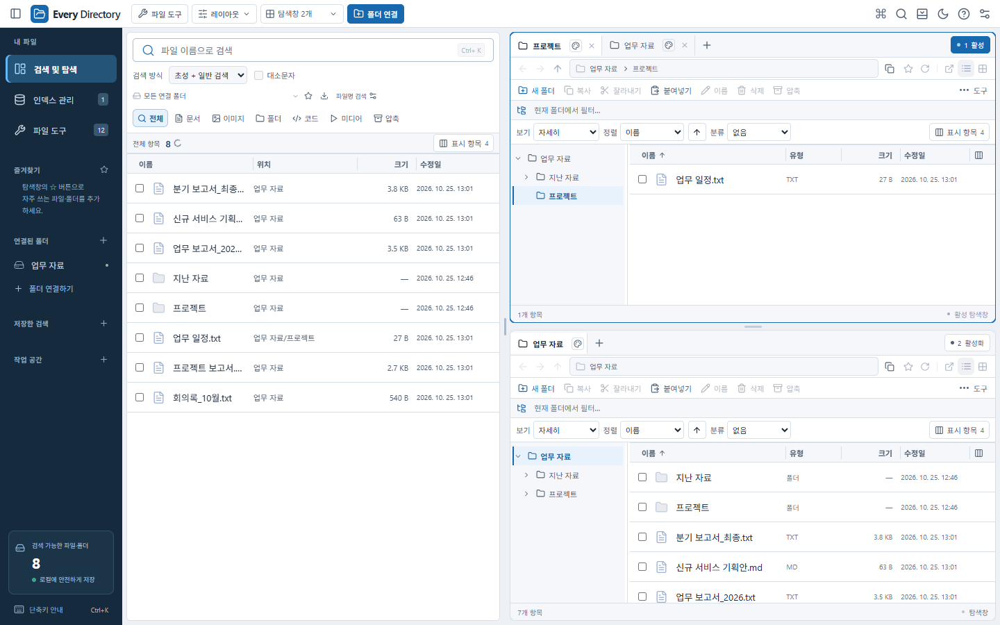
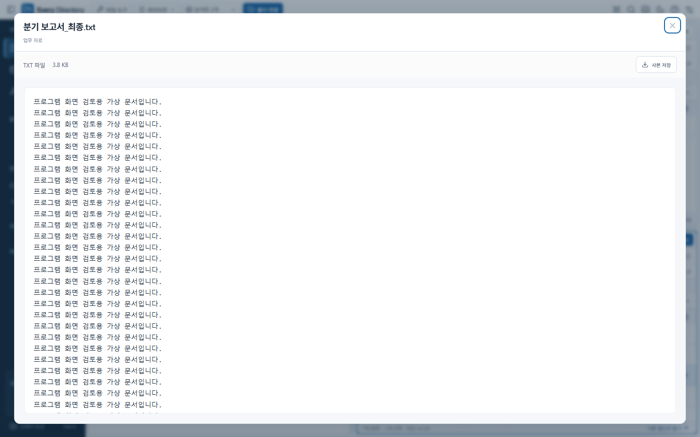
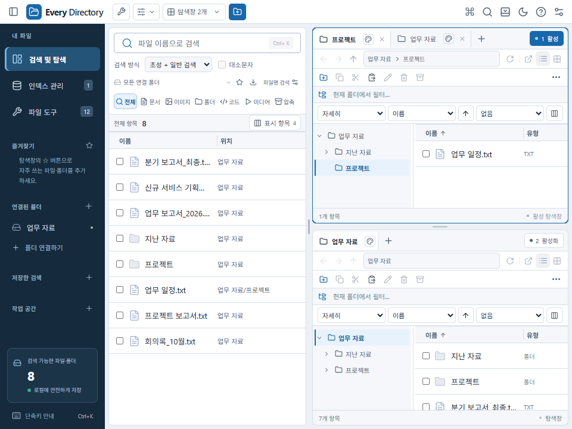
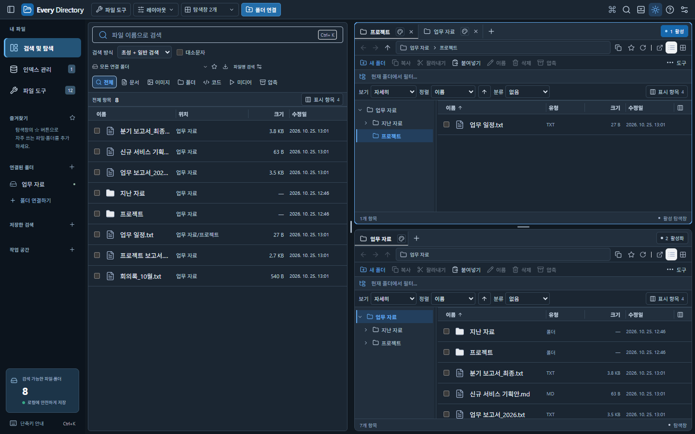

# Every Directory — 사용성·디자인 상세 검토

대상: 빠른 파일 검색과 다중 탐색창을 함께 사용하는 데스크톱 업무 환경. [기능 변경·추가 개발 계획](../windows-explorer-v0.9.0.md)과 함께 본다.

실제 React 화면을 1440×900·960×720, 라이트·다크로 렌더링해 살펴보고 DOM 치수·계산된 색을 측정했다. 화면 자료는 **가상 업무 파일과 공식 Tauri IPC mock을 사용하는 브라우저 렌더링**이다. 실제 Windows 파일 작업 검증은 별도 Tauri/WebView2 E2E로 수행했다. 이 보고서는 실제 사용자 인터뷰나 전체 WCAG 인증 결과가 아니다.

## 전체 판단

검색과 활성 탐색창의 연결, 여러 창의 독립 탭, 짧은 상단 바는 업무 흐름에 맞는다. 가장 큰 개선 여지는 **각 탐색창 내부의 여러 도구 줄이 차지하는 높이**, **작은 보조 글자와 클릭 대상**, **파일명을 읽는 공간 배분**이다. 장식보다 목록 영역과 상태의 명확성을 우선해야 한다.

## 이번에 반영한 디자인 개선

| 항목 | 반영·효과 |
|---|---|
| 트리 경계 발견성 | 오른쪽에 항상 보이는 선, 호버/초점 강조, 드래그 커서. 키보드 조절·취소·기본값 복구 |
| 크기 설정의 예측 가능성 | 탭 이동으로 트리 폭이 바뀌지 않도록 창 단위 저장. 작은 창에서는 표시만 제한 |
| 보기 설정의 접근성 | 보기·정렬·분류·표시 칼럼을 한 곳에 모으고 각 창의 설정을 독립 저장 |
| 작은 창의 높이 낭비 | 960×720에서 새 설정 줄이 두 줄 67px로 늘어나던 것을 한 줄 35px로 줄임. 해당 목록 높이 80→112px |
| 읽기용 미리보기 | 94svh, 최대 1,440px/96vw. 본문 14px·줄 간격 1.65·진한 텍스트. 메타데이터 12px |
| 속성 선택의 익숙한 위치 | 별도 버튼 외에 헤더 우클릭에서도 속성 선택. 기존 너비 조절 메뉴와 통합 |
| 작업 대상 안정성 | 자동 인덱스 갱신이 선택을 지우지 않게 보완. 접근 시각 변경으로 페이지가 다시 시작되지 않게 처리 |
| 제외 설정의 설명 | ‘검색·인덱싱에서 제외, 탐색은 유지’를 명시. 하위 경로·재인덱싱·다시 포함 방법 설명 |

## 1. 첫인상·정보 우선순위

활성 창의 파란 경계와 번호가 작업 대상을 구분한다. 전체 앱의 상단은 40px로 얇고 파일 목록이 바로 시작되어 이전의 큰 소개 공간 문제를 줄였다. 검색어 입력이 왼쪽 위에 있고 연결 폴더·즐겨찾기가 같은 방향에 있어 기본 동선은 일관된다.

반면 탐색창 안에는 탭·주소·파일 작업·현재 폴더 필터·보기 설정·칼럼 헤더가 차례로 놓인다. 하나씩 필요하더라도 모두 상시 노출하면 실제 작업 영역이 줄어든다. 파일을 선택하지 않았을 때 비활성 작업 버튼이 줄을 차지하는 점도 개선할 여지가 있다.

## 2. 사용성 발견과 권고

심각도는 업무 영향에 따른 전문가 검토 우선순위다. P1은 다음 사용성 개선의 우선 대상, P2는 후속 개선이다.

| 발견 | 우선순위 | 사용자 영향 | 권고·완료 기준 |
|---|---|---|---|
| 창 내부 도구 줄이 많음 | P1 | 작은 화면·다중 창에서 목록 몇 줄만 보임 | ‘작업 집중’ 모드: 탭 32px·주소 32px·상황별 도구 32px·헤더 26px로 약 122px 목표. 보기/분류는 팝오버로 접근. 720px 높이에서도 각 창 목록 50% 이상 목표 |
| 파일명이 짧게 잘림 | P1 | 비슷한 보고서의 연도·최종 버전 구분 어려움 | 이름 우선 기본 폭, 좁은 창에서 위치를 보조 정보로 전환하는 선택 모드, 전체 이름 툴팁/키보드 접근 유지 |
| 10~11px 보조 글자가 많음 | P1 | 오래 읽거나 고해상도 환경에서 피로 | 편안함 모드는 이름 13~14px·메타데이터 12px, 촘촘 모드는 별도 제공. 행 높이뿐 아니라 글자 크기도 조절 |
| 선택·검색·탐색의 범위가 다름 | P1 | Ctrl+A/내보내기의 대상을 전체 검색으로 오해 가능 | ‘불러온 N개 중 M개 선택’과 전체 결과 수를 함께 표시. 범위를 작업 확인창에 반복 |
| 긴 파일 작업 상태가 약함 | P1 | 멈췄는지 처리 중인지 판단 어려움 | 작업 큐·파일 수/바이트 진행률·취소·실패 항목 표시. 완료 후 확인 가능한 기록 |
| 기본 탐색기 버튼이 아이콘 중심 | P2 | OS 별도 창이라는 차이를 알기 어려움 | 좁지 않은 창에서 ‘Windows 탐색기’ 텍스트 또는 메뉴 항목 병행. 별도 창이며 상태가 동기화되지 않음을 명확히 안내 |
| 검색 불가 원인이 한눈에 보이지 않음 | P2 | 제외/권한/오프라인/감시 오류를 혼동 | 인덱스 관리에 제외 수·건너뜀 이유·최근 갱신·감시 상태 구분. 해당 경로 바로 확인 |
| 새 보기·분류 상태를 찾으려면 각 창을 확인해야 함 | P2 | 여러 창의 기준이 다른 이유를 놓침 | 선택된 기준을 짧은 상태 표시로 제공하고 ‘보기 초기화’ 제공. 이름·색만으로 상태를 전달하지 않기 |
| 탭의 작은 색상·닫기 대상 | P2 | 실수로 닫거나 색을 바꿀 수 있음 | 아이콘 시각 크기와 무관하게 클릭 영역 확대, 키보드 경로 병행. 고정 탭과 닫은 탭 복원 유지 |
| 분류 헤더의 접기 기능 없음 | P2 | 긴 그룹 사이 탐색 비효율 | 키보드 접근 가능한 접기, 접힌 그룹과 전체 선택의 범위를 정의한 뒤 추가 |
| 칼럼 순서가 고정됨 | P2 | 업무별 날짜·크기 우선 배치 어려움 | 헤더 순서 이동과 기본값 복구. 포인터·키보드 모두 지원하고 창별 저장 |
| 설정 저장 단위가 사용자에게 잘 드러나지 않음 | P2 | 탭별/창별/앱 전체 설정을 혼동 | 설정에 적용 범위 표시. 트리 펼침=탭, 너비·보기=창, 테마·글자=앱 전체로 일관화 |

## 3. 공간·가독성 측정

두 창이 오른쪽에 위/아래로 놓인 동일한 가상 업무 구성의 첫 탐색창을 측정했다. 모든 배치의 평균 수치가 아니다.

| 항목 | 1440×900 | 960×720 | 의미 |
|---|---:|---:|---|
| 앱 상단 높이 | 40px | 40px | 전역 헤더는 이미 비교적 작음 |
| 검색 조작 영역 | 144px | 144px | 접이식 고급 필터로 더 줄일 여지 |
| 새 보기 설정 줄 | 35px | 35px | 작은 창에서 두 줄이 되지 않도록 보완 |
| 첫 창의 파일 목록 높이 | 202px | 112px | 작은 창에서는 여전히 충분하지 않음 |
| 트리를 제외한 목록 폭 | 약 526px | 약 256px | 파일명·여러 속성의 기본 폭 재배분 필요 |
| 문서 전체의 가로 넘침 | 없음 | 없음 | 개별 표는 필요한 경우 자체 가로 스크롤 |

작은 화면에서 사이드바 접기, 트리 숨기기, 검색/탐색 분할 조절, 한 창 보기를 활용할 수 있다. 장기적으로는 이 조작을 한 번에 적용하고 되돌릴 수 있는 **작업 집중 프로필**을 권장한다. 사용자 설정을 자동으로 바꿔 버리는 방식은 피하고 전환 버튼과 복원 동작을 제공한다.

## 4. 일관성

| 항목 | 현재 | 개선 방향 |
|---|---|---|
| 앱 색상 | 표면·본문·강조색 변수와 다크 테마 사용 | 새 컴포넌트도 동일 변수 사용. 존재하지 않는 텍스트 변수는 정리 |
| 단축키 | Ctrl+C/V·Insert·Delete·Space·주소 이동 등 제공 | 실제 탐색창/검색창/입력 필드의 처리 범위를 도움말에서 구분 |
| 폴더 경로 | 주소·트리·탭 위치 연결 | OS 기본 탐색기는 별도 상태라는 차이를 명확히 표시 |
| 속성 용어 | ‘수정일’, ‘만든 날짜’, ‘액세스한 날짜’, ‘유형’ | Windows와 비교하기 쉬운 표현으로 통일하고 확장자와 유형을 구분 |
| 크기 조절 | 칼럼·분할·트리 각각 조절 가능 | 경계선·커서·키보드·기본값 복구 동작의 공통 규칙 유지 |
| 설정 복원 | 저장값 검증·기본값 복구 | 향후 폴더별 프로필을 추가할 때 창 설정과의 우선순위 명시 |

## 5. 접근성

계산된 전경·배경색으로 측정한 일부 대표 텍스트의 대비다. 안티앨리어싱된 이미지 픽셀을 역산한 수치는 아니다. 일반 텍스트의 4.5:1 기준은 [W3C의 대비 안내](https://www.w3.org/WAI/WCAG22/Understanding/contrast-minimum.html)를 참고했다.

| 대표 요소 | 전경 / 배경 | 대비 | 판단 |
|---|---|---:|---|
| 보기 설정 라벨 | #516174 / #ffffff | 6.34:1 | 표본 통과 |
| 사이드바 구분 라벨 | #8da5bb / #152a3c | 5.76:1 | 표본 통과, 10px 크기는 별도 개선 필요 |
| 트리·칼럼 헤더 | #516174 / #f5f7fa | 5.91:1 | 표본 통과, 10~11px 크기는 별도 검토 |
| 다크 보기 선택 상자 | #e4edf6 / #1b2632 | 12.95:1 | 표본 통과 |

색 대비가 충분해도 작은 글자가 편해지는 것은 아니다. 본문 크기·줄 간격·파일명 공간을 함께 개선해야 한다.

화면에 보이는 버튼 중 너비와 높이가 모두 24px 미만인 대상이 이 구성에서 13개 확인됐다. 이는 보조 검사 수치이며 간격 예외·라벨 영역·비활성 여부를 따진 전체 적합성 판정은 아니다. 탭 닫기·색상·트리 토글을 우선 점검하고, 보이는 아이콘을 크게 만들기보다 투명한 클릭 영역을 확보하는 방식을 권장한다.

트리 너비 조절은 키보드·명시적 이름·값·방향을 제공한다. 속성 선택은 이름 칼럼을 유지하고 Esc로 닫을 수 있다. 작은 창에서 숨긴 보기 라벨은 접근 가능한 이름으로 유지한다. 색상 외에도 선택 배경·활성 창 경계·탭 고정 아이콘을 제공한다. 스크린리더·고대비 테마·200% 배율·모든 초점 경로는 별도 전수 검증이 필요하다.

## 우선 실행 계획

1. **작업 집중 모드와 글자 크기**: 좁은 창의 목록 높이와 파일명 읽기부터 개선. 960×720·1440×900·150/200% DPI에서 긴 한국어 이름으로 확인한다.
2. **범위·작업 상태 표시**: 불러온 결과/전체 검색/선택 항목과 작업 대상 창을 명시하고 작업 진행·실패 내역을 제공한다.
3. **기능 발견성**: 기본 탐색기·속성 선택·보기 초기화의 이름을 보완하고 첫 사용 시 짧은 안내를 제공한다.
4. **설정 프로필**: 창별 기본값과 폴더별 문서/사진 프로필을 구분하고 원래 구성으로 복원하는 경로를 제공한다.
5. **사용자 과업 검증**: 초성으로 보고서 찾기 → 위치 확인 → 다른 창으로 3개 복사 → 제외 폴더 지정 → 재실행 후 구성 복원을 과제로 삼는다. 초보/숙련 사용자별 완료 시간·오류·되돌리기·대상 혼동을 기록해 현재 구성과 비교한다. 아직 수행한 사용자 실험은 아니다.
