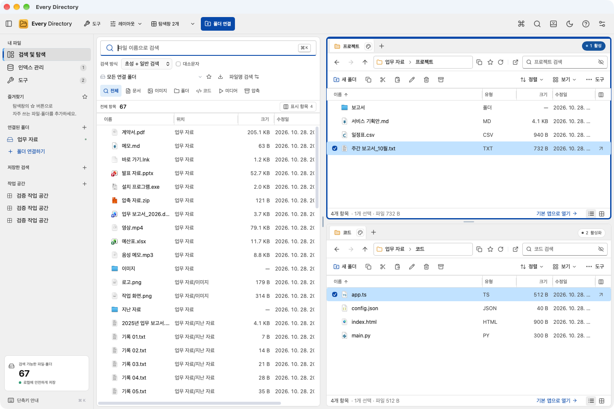

# Windows 친화 화면·키보드 커서·OS 아이콘·클립보드 — 0.11.0

## 화면(Windows 11 파일 탐색기 기준)

- 색·글꼴·간격을 Windows 11(Fluent) 기준으로 바꿨다. Windows는 `Segoe UI Variable`·`맑은 고딕` 12px, macOS는 시스템 글꼴 13px을 쓴다. 라이트·다크 모두 적용한다.
- 왼쪽 패널은 어두운 남색 대신 탐색기의 밝은 탐색 창 모양이며, 선택 항목은 왼쪽 강조 막대로 표시한다.
- 파일 목록은 탐색기 ‘자세히’ 보기처럼 행 높이 32px(촘촘하게 26px), 마우스 올림 `#e5f3ff`·선택 `#cce8ff`를 쓴다. 확인란은 마우스를 올리거나 선택한 행에만 보인다.
- 탐색창 도구 줄을 6줄에서 4줄로 줄였다.
  - **주소줄 오른쪽 검색 상자**: 기존 ‘현재 폴더에서 필터’를 탐색기 검색 상자 위치로 옮겼다(placeholder: `○○ 검색`).
  - **명령 막대**: 새 폴더·복사·잘라내기·붙여넣기·이름 바꾸기·삭제·압축 + 오른쪽 `정렬 ▾`·`보기 ▾`·`도구`. 폭이 820px보다 좁으면 Windows 11처럼 보조 명령은 아이콘만(도구 설명 제공), 560px보다 좁으면 모든 이름을 숨긴다.
  - `정렬 ▾`: 정렬 기준 목록·오름/내림차순·분류(그룹). `보기 ▾`: 아주 큰 아이콘~내용 8가지·폴더 트리(탐색 창)·표시 항목. 바깥 클릭이나 Esc로 닫는다.
- 우클릭 메뉴·대화상자·알림은 8px 모서리와 Fluent 그림자, 단축키는 테두리 없는 회색 글자로 표시한다. 스크롤 막대·초점 테두리도 Windows 11 형태다.
- Windows에서 명령 이름은 ‘이름 바꾸기’, macOS는 ‘이름 변경’이다.

## 키보드 커서 유지

| 동작 | 이전 | 0.11.0 |
|---|---|---|
| 폴더에서 Enter·더블클릭 | 초점이 사라짐 | 새 폴더의 첫 항목을 선택하고 초점 |
| Backspace·Alt+↑·뒤로/앞으로 | 초점이 사라짐 | 방금 나온 하위 폴더를 선택하고 초점(탐색기와 동일) |
| 삭제 | 선택·초점이 사라짐 | 같은 자리의 다음 항목을 선택 |
| 이름 바꾸기 | 선택·초점이 사라짐 | 새 이름의 항목을 선택 |
| 검색창·현재 폴더 검색 상자에서 ↓ | 동작 없음 | 결과 목록의 선택 항목(없으면 첫 항목)으로 이동 |
| 행에서 Alt+↑ | 목록이 방향키로 가로채 동작하지 않음 | 상위 폴더로 이동 |
| Tab | 모든 행을 하나씩 지나감 | 목록은 Tab 정지점 하나(roving tabindex) |

## 운영체제 아이콘

- 새 `edicon` 프로토콜이 Windows는 셸 시스템 이미지 목록(`SHGetFileInfoW`·`SHGetImageList`), macOS는 `NSWorkspace` 아이콘을 PNG로 만들어 제공한다. 확장자별로 한 번만 만들고 캐시한다.
- `.exe`·`.lnk`(바로 가기 화살표 포함)·`.ico`·`.url` 등과 macOS 앱 번들(`.app`)은 파일마다 실제 아이콘을 쓴다.
- 화면 배율에 맞는 크기(16·32·48·256px)를 요청한다. 보통·큰·아주 큰 아이콘 보기에서는 PNG·JPEG·WebP·GIF·BMP(20MB 이하)를 미리보기 그림으로 보여 준다.
- 웹 버전·아이콘 실패 시에는 형식별 색 아이콘(노란 폴더 등)으로 대체한다.

## 클립보드 이력

- 빠른 검색에서 `clip`으로 이력을 열면 창이 720×540에서 **1040×760**(모니터 작업 영역 안)으로 커지고, 파일 검색으로 돌아오면 원래 크기로 줄어든다. 범위·종류 선택 줄을 숨겨 목록 공간을 넓혔다.
- **종류 탭**: 전체·텍스트·이미지·파일·즐겨찾기와 각 개수. 클릭, 탭에서 ←/→, `Ctrl/⌘+1~5`로 바꾼다.
- 한 줄 미리보기·종류 아이콘·‘방금/n분 전/오늘/어제’ 시각으로 한 화면에 10개 안팎이 보인다. PageUp/PageDown·Home/End로 이동한다.
- **macOS 자동 기록 추가**: 붙여넣기 보드 변경 횟수로 감지한다. 비밀번호 관리자의 `org.nspasteboard.ConcealedType`·`TransientType`·`AutoGeneratedType` 표시와 제외 앱(이름 또는 `.exe` 표기)을 존중한다. macOS 이력은 현재 사용자만 읽을 수 있는 파일(0600)로 보관하며 Windows처럼 별도 암호화하지는 않는다. 파일 이력의 클립보드 복원도 macOS에서 지원한다.

## 기타

- Node.js는 `22.23.4 · 24.22.1 · 26.12.1`로 고정했다(`.nvmrc` 24.22.1, CI는 `.nvmrc`를 따른다).
- E2E 실행기(`npm run test:e2e`)가 macOS에서도 동작한다. macOS는 플랫폼 공용 스위트 `ux`·`quick`·`empty`·`desktop`을 실행하고, 클립보드를 쓰는 스위트는 `scripts/clipboard-guard-mac.swift`로 모든 형식을 메모리에 백업·복원한다. Windows는 기존 19개 스위트에 `ux`를 더해 실행한다.

## 검증

- macOS WKWebView 실제 앱 E2E 4개 스위트·100개 항목 통과: `ux` 32개, `quick` 19개, `empty` 3개, `desktop` 46개.
- TypeScript/웹 서비스 69개, Rust 61개 통과(새 아이콘 주소 해석·macOS 아이콘 PNG 생성 포함, 선택 성능 검증 4개는 별도).
- 배포 파일: `releases/v0.11.0/`(macOS arm64 DMG·ZIP, Windows x64 설치 EXE·포터블 ZIP, `SHA256SUMS.txt`, `verification.json`). 설치 파일 자체는 Git에 넣지 않는다.
- Windows 코드(셸 아이콘·클립보드)는 `x86_64-pc-windows-msvc` 교차 컴파일과 설치 파일 빌드까지 확인했다. **Windows 실기기 WebView2 E2E는 이 변경에서 실행하지 못했으므로** Windows PC 또는 CI(`desktop.yml`)에서 `npm run test:e2e`로 확인해야 한다.
